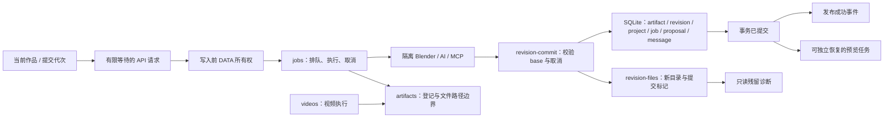

# 工程稳定性整改：P1.0–P2.4

日期：2026-10-12。依据此前工作区 PROJECT_AUDIT.md 的有限整改路线；不包含 P2.5 大组件拆分、P2.6 数据迁移和 P3 清理。

## 源码与交付来源

- 正式来源为 GitHub `main`。本轮开始已核对远端提交 `211939dbdd856998d14a917516b19624d91dccf9`；上一发行标签 `v1.1.0` 对应 `1f489e16ddace679e42c2412afd515585e852a9b`。前者只多一项控件高亮样式修复。
- 旧主工作区位于早期任务分支，有 26 个跟踪文件修改和大量未跟踪内容。它是保留的开发副本，不能用其 HEAD 构建完整发行版。先保存代码/文档归档与 SHA256 清单，未覆盖、回退或提交其中原有工作。
- 审计列出的 135 个代码/CSS 文件中，110 个与 1.1.0 发行源码逐字节一致，23 个存在发布差异，2 个本地交付辅助脚本不在发行树。差异包括桌面凭据边界、图标/网格、封面、材质/视频兼容和测试导航适配；整改沿用主线这些实现，不把整个旧副本混入 PR。
- `desktop/`、桌面构建/验证脚本与 `.github/workflows/` 已在主线存在；版本与文档指向同一正式代码。原审计的“目录缺失”描述仅适用于旧副本。
- 本轮在基于主线的独立 `codex/engineering-stability-p1-p2` 工作树实施。独立执行 `npm ci`；GitHub API 核对当前分支与发行来源；未执行真实 AI 建模或操作用户作品。

## 验收清单

每组保持独立提交与回滚。下表列出本轮验收范围，实测结果与提交见后文。

| 轮次 | 必须证明的行为 |
| --- | --- |
| P1.0 | 明确来源、保护旧副本；独立安装、build、safe tests；文档命令存在。 |
| P1.1 | 所有作品数据写入口先取得所有权；同/异端口第二实例不恢复已有任务、不杀合法 worker；陈旧锁/正常退出处理。 |
| P1.2 | 保存后预览排队失败不将主任务/方案改失败；已保存版本可继续预览；提交前失败仍不发布。 |
| P1.3 | sync/edit/video/retry 与错误响应归属正确；切作品或换任务后迟到结果不污染新上下文。 |
| P1.4 | 默认仅安全 mock；独立前端服务、API 未模拟即失败；live 显式启用且隔离；原失败 UI 回归恢复。 |
| P2.1 | 失败提交只补偿本次目录；磁盘/DB失败保持旧成果；崩溃残留有标记与只读诊断，不自动删除未知作品。 |
| P2.2 | 小版本生产依赖补丁；上传/MCP/构建/真实无AI Blender行为保持；锁文件可回滚。 |
| P2.3 | 401/500/断线/挂起时提示与锁闭环；请求失去响应先核对已接受任务，不盲目重发写操作。 |
| P2.3a | 合法关键词名称成功；真实工具错误、缺/坏/多marker仍拒绝。 |
| P2.3b | 有界深子树遍历保持顺序与ID；真实模态Tab/Escape/关闭/焦点返回正确。 |
| P2.4 | artifact与提交职责独立；jobs↔videos运行时循环断开；版本、取消、预览、视频与文件归属保持。 |

## 验证与发布边界

所有数据库/执行故障注入仅使用独立临时 DATA；AI和GUI用户场景不参与默认回归。单元/mock/固定Blender场景只能证明相应层，不能保证任意照片建模质量、复杂场景或所有设备。

源码提交后按既有 CI/PR 要求合入；桌面包仅在来源提交明确、独立包验收成功后按原发布流程交付。日志、缓存、构建包、认证资料和用户作品不进入源码提交。

## 责任与提交边界

- `jobs` 保留排队与业务编排；`artifacts` 不导入 `jobs`，`videos` 直接依赖 `artifacts`。旧 artifact exports 保留，现有脚本接口不变。
- `revision-commit` 只提交已经验证的产物与核心索引。成功 Job 使用独立快照，在 SQLite transaction 返回后才更新内存并发布事件；消息写入失败不能提前发出“成功”。
- 文件系统与 SQLite 不能变成同一原子事务。失败只补偿本次随机 ID、token 匹配的目录；进程硬退出可能留下 `.commit-pending.json`，只读报告后人工核对，不自动删除未知作品。
- `active-record` 表示数据库仍有 queued/running 记录，不能证明 worker 仍存活；`interrupted`、`committed-marker`、`untracked`、`invalid-marker`、`blocked-path` 同样是诊断线索，不能直接当作删除许可。

## 运维与回滚

- 本轮不改 Schema、作品目录路径或已有对象 ID，不自动重发写请求、不重放中断的 AI 任务。
- `ZAOWU_DATA_DIR=/绝对/作品目录 npm run check:revision-files` 只读取索引和标记，可以在后台持锁时执行；输出不包含模型内容或凭据。先备份、核对业务记录与 owner/worker，再决定任何后续清理。
- 进程身份统一使用 C/UTC，并在新 owner 记录标明格式。旧/未知格式活 PID 一律拒绝，不把语言、时区差异当作 PID 重用；只有确认 PID 已不存在才自动回收。旧 worker 登记无法与统一出生时间匹配时不自动终止，应先正常退出旧应用再升级。普通 owner 被 SIGKILL 后可在重启回收。若“陈旧锁回收”自身在极短窗口被 SIGKILL，恢复守卫会保留，后续启动安全拒绝写入。确认工作台和维护进程均退出、owner PID 与出生时间无合法 writer 后，才处理空 `.desktop-owner-recovery`；坏 owner JSON 同理，不能直接当作旧锁删除。
- 每组使用独立提交，回退源码/依赖锁即可撤回相应行为；撤回不删除本轮或既有作品。提交标记仅是额外文件，旧版本不读取它。桌面安装沿用现有脚本，保留旧 app 与 Dock 备份，作品和设置原位保留。
- 默认 mock suite 不启动后台、不代理到日常端口、不允许未 mock 的 API 或外部请求。真实浏览器/历史 CLI 验收必须明确 opt-in，并在系统临时 `formadesk-live-*` DATA 与独立 URL 上执行；真实 AI 还需单独 opt-in。

## 实测完成记录

| 轮次 | 实现提交 | 实际证据 |
| --- | --- | --- |
| P1.0 | `7b93123` | 正式 main/发行来源核对；243 个旧副本文件归档与 SHA256 清单；独立 npm ci/build。 |
| P1.1 | `10f7b99`、`ff32866` | data-lock 12 项、startup 14 项、process birth 3 项；同/异端口第二实例拒绝，6 进程陈旧锁竞争仅一个胜者；SIGKILL 恢复及 ready 后 SIGTERM；跨语言/时区仍拒绝活 owner。 |
| P1.2 | `3d01bfe` | 保存后排队失败仍成功，预览可继续、方案不降级；5 项 commit 与 3 项 preview 回归。 |
| P1.3 / P2.3 / 键盘 | `6a4b9d1`、`145aceb` | 21 项前端边界、11 项 API 回归；迟到响应、未知写结果核对、失效健康/状态与实际模态焦点。 |
| P1.4 | `bc6a5fa`、`34ea6a3`、`dbffda2`、`9914e3e` | 默认 safe browser 48/48；原 5 条失败恢复；20 旧脚本 54 次实际子进程拒绝、6 项 guard；另 5 项浏览器负向护栏按预期拒绝。 |
| P2.1 | `53ad853` | ENOSPC、SQLite rollback、真实 SIGKILL 遗留；4 项文件归属/残留，旧成果与其他作品保留。 |
| P2.2 | `b72a3a8` | Fastify 5.12.5 / MCP 1.31.0 / sharp 0.35.5；生产 npm audit 7→0；原生图片/SQLite、上传坏文件与协议回归；完整开发链仍 11 项需另轮工具升级。 |
| P2.3a / 子树 | `6dfadc3` | MCP 19 项；Python 子树 11 项（含1200/1500层及超限/环/重复节点）；实际 Blender helper 导入/顺序/ID。 |
| P2.4 | `310b4c5`、`7126fae` | artifact 独立与无 jobs↔videos 循环；成功后消息写入失败不广播成功；23 项版本/取消/恢复/提交定向回归及真实新旧 .blend。 |

整体验证：`npm test` **26 文件 / 138 项通过**；`npm run test:python` **3 插件 + 11 子树通过**；TypeScript/Vite 构建与独立 `.app` 打包通过；保留主包 >500KB 提示，没有为压分或体积提示改业务。

真实 Blender smoke：AI 调用 **0**，两类沙箱读/写/本机及外网阻断、凭据隔离；固定立方体重命名后新 revision/parent/对象 ID/artifact 归属正确，旧模型 SHA 不变；新 .blend 再打开正确、0400 核心文件与无提交残留通过。

候选 `.app` 已复制到源码之外、以最小 PATH 运行：packaged 模式、私有会话和列表凭据范围、12 对象真实 GLB、GLB/.blend 原生下载、512×512 Blender PNG、640×360 短录制保存/下载、退出释放后台与锁、重启恢复作品均通过。首次桌面验收发现旧全局“下载原图”选择器同时命中详情与弹窗，已定位至实际成品图对话框并明确关闭后继续视频，原下载/尺寸断言保留。

源码 PR 必须通过本轮新增 CI：完整 unit、Python、build、安装隔离 Chromium、safe browser、浏览器负向护栏与生产 audit。发行/本机替换使用通过这些检查后合并的干净版本；最终状态以 GitHub PR/Release 及安装包 build-info 为准，不能将上述候选包的来源元数据充当最终发行来源。
